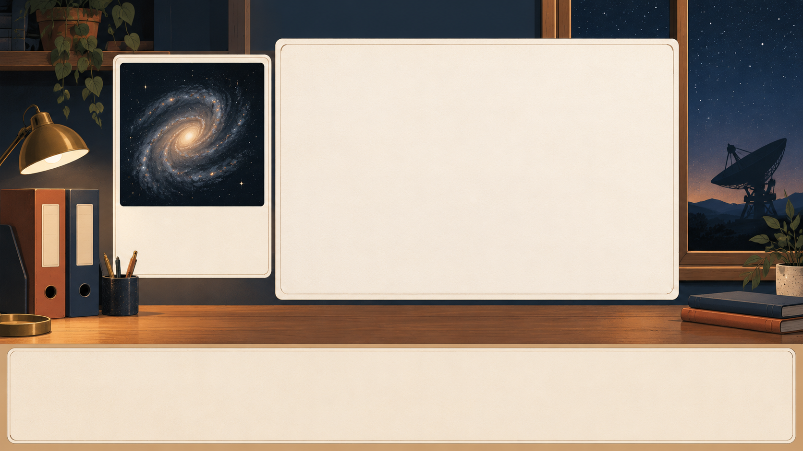
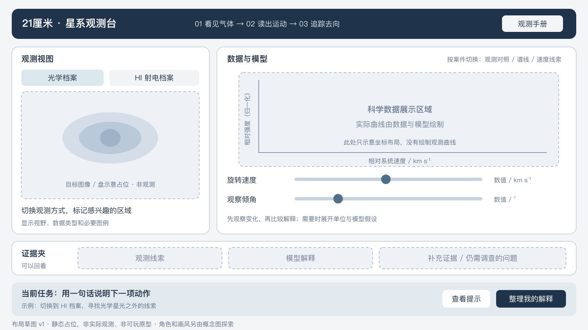

# 第一轮美术与界面布局

- 日期：2026-10-14，Asia/Shanghai
- 用途：为学生与大众取向的 2D 星系侦探游戏探索视觉方向。
- 状态：三张候选图已生成并保存；用户已选定 B。
- 产品入口：[一页产品说明](../PRODUCT_BRIEF.md)

## 三种方向

| 方向 | 核心气质 | 保留的游戏信息结构 | 比较重点 |
| --- | --- | --- | --- |
| A 温暖手绘观测室 | 深蓝夜景、暖灯、纸质档案、手绘质感 | 观测视图、主数据面板、下方任务区 | 是否愿意在这个地方探索和停留 |
| B 暖色观测室与浅色档案卡（已选） | 暖色背景、浅色大卡片、纸面质感与明确的数据区域 | 与 A 相同 | 图表与操作是否更容易辨识 |
| C 轻科幻射电工作站 | 深色控制台、适量冷色发光、真实地面观测站线索 | 与 A 相同 | 是否有故事氛围，同时保留可读性 |

三种概念图保持相近的功能分区，用于比较气质。它们是美术探索，尚不是可运行截图或可直接拆分的最终游戏素材。B 原先探索的是简洁档案馆方向，实际生成结果保留了暖色室内背景，用户选择的是这张实际结果，以图片本身为视觉基准。

| 方向 | 项目内图片 | 当前用途 |
| --- | --- | --- |
| A | [温暖手绘观测室](../../assets/concepts/concept-a-warm-observatory-v1.png) | 保留对照 |
| B | [暖色背景与浅色档案卡](../../assets/concepts/concept-b-galaxy-archive-v1.png) | 已选视觉基准 |
| C | [轻科幻射电工作站](../../assets/concepts/concept-c-radio-workstation-v1.png) | 保留对照 |

概念图中的数据面板预留空白，不把生成式装饰线条当作科学谱线。实际曲线、轴线、速度信息和动态示意将在实现时根据数据绘制。

## 本轮图片生成记录

- 使用内置 imagegen 工具，三个方向各生成一次；不使用 CLI / API 回退。
- 最终完整提示词保存在 [concept-prompts.json](concept-prompts.json)，字段 `prompt` 即实际提交文本。
- 三张图片均已从工具默认输出位置复制到项目的 `assets/concepts/`，原始输出保留；各为 1672×941 像素、RGB PNG。
- 本轮候选图片均为生成式概念插画，不是真实观测，不是已完成的游戏画面。

## 界面草图

[SVG 草图](../../assets/wireframes/observatory-layout-v1.svg)为可编辑的布局源文件，[PNG 预览](../../assets/wireframes/observatory-layout-v1.png)为 1600×900 像素的渲染结果，已进行视觉检查。它表达信息顺序和操作区域；所有视图、谱线和参数状态均为静态占位。当前使用中性配色，后续基于 B 完善视觉，不把布局占位误当成最终皮肤。

| 区域 | 作用 | 后续必须验证的事项 |
| --- | --- | --- |
| 顶部案件条 | 提示当前案件和进度，打开观测手册 | 案件名称是否易懂，进度是否清楚 |
| 左侧观测视图 | 在光学 / HI 档案中查看同一目标 | 相同视野与坐标对齐，数据类型明确 |
| 右侧数据与模型 | 谱线、模型联动、旋转速度和倾角滑块 | 轴名、单位、投影约定和参数关系正确 |
| 左下证据槽 | 保存玩家标记的线索与解释 | 证据能否回看，是否支持最终判断 |
| 下方任务栏 | 给出当前一个动作，展开提示和提交解释 | 首次操作不依赖阅读长教程 |

三个案件切换时，右侧面板可以改为观测对照、谱线或速度线索；不要求三个案件同时显示全部仪器。

## 素材制作约定

- 初版按 16:9 工作画面排版，实际游戏需适应常见桌面窗口。
- 背景、角色、UI 与文字分开；文字和数据标记由程序排版。
- 如果使用角色，先做头像，不先制作行走动画。
- 关键线索同时使用标记、形状和文字表达，颜色只承担一部分信息。
- 正式制作时再拆分按钮、背景和图标，本轮概念图不直接充当整张可点击界面。
- 图中射电望远镜位于地面观测站环境；避免把射电观测画成肉眼观察或光学目镜操作。

## 选图时只需看三个方面

1. 哪个画面最想让人点进去玩？
2. 文字和数据放进去之后，是否容易看清？
3. 希望保留哪种气质、删掉哪些装饰？

用户已选定 B，本文件已记录选择；A、C 保留，便于回看取舍。角色和布局仍是可调整草案。
